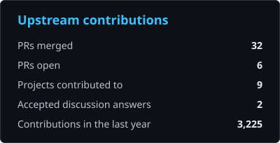
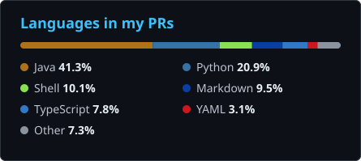

<!-- AUTO-GENERATED from README.template.md — do not edit by hand -->

# Ayan Alam

Open source contributor · Java server work & web frontends

I contribute bug fixes, cleanups and docs to open source projects. **22 merged upstream PRs** so far, mostly in Apache HugeGraph and Open Food Facts.

On [Apache HugeGraph](https://github.com/apache/hugegraph) I work across the Server, PD and Store modules and their Docker and Helm setup: running the images as a non-root user, sizing the RocksDB memory budget from available memory, keeping crash diagnostics after a container restart, binding locally loaded graphs in Gremlin Server, removing dead scheduler and election code, and updating the docs to match.

On [Open Food Facts](https://github.com/openfoodfacts) I fix bugs in [Explorer](https://github.com/openfoodfacts/openfoodfacts-explorer) (SvelteKit) and the [Open Prices](https://github.com/openfoodfacts/open-prices-frontend) frontend (Vue).

Outside upstream work I'm building [Alpha Region](https://github.com/byteayan/Alpha-Region-Prototype), a dashboard UI in plain HTML, CSS and JavaScript with hand-rolled canvas charts and an SVG heatmap.

## Upstream work

| Project | PRs | Focus |
| --- | --- | --- |
| [Apache HugeGraph](https://github.com/pulls?q=is%3Apr+author%3Abyteayan+repo%3Aapache%2Fhugegraph+repo%3Aapache%2Fhugegraph-doc) | 15 merged · 1 open | Server, PD and Store fixes, non-root Docker images, RocksDB memory sizing, crash diagnostics, deployment docs. Latest: <a href="https://github.com/apache/hugegraph-doc/pull/535">#535</a> — docs(store): document the auto-sized RocksDB memory budget |
| [Open Food Facts](https://github.com/pulls?q=is%3Apr+author%3Abyteayan+repo%3Aopenfoodfacts%2Fopenfoodfacts-explorer+repo%3Aopenfoodfacts%2Fopen-prices-frontend) | 5 merged · 3 open | Explorer (SvelteKit) and Open Prices (Vue) fixes: links, forms, the proof assistant, product comparison, CI. Latest: <a href="https://github.com/openfoodfacts/openfoodfacts-explorer/pull/2074">#2074</a> — fix(prices): link to the maintained Open Prices add page |
| [Zulip](https://github.com/pulls?q=is%3Apr+author%3Abyteayan+repo%3Azulip%2Fzulip) | 1 merged · 1 open | Cache flushing when email visibility changes, status emoji rendering. Latest: <a href="https://github.com/zulip/zulip/pull/40192">#40192</a> — user_settings: Flush caches keyed by old email on visibility change. |
| [Rocket.Chat](https://github.com/pulls?q=is%3Apr+author%3Abyteayan+repo%3ARocketChat%2FRocket.Chat) | 0 merged · 2 open | UI fixes for the home page and the emoji picker. Open: <a href="https://github.com/RocketChat/Rocket.Chat/pull/42158">#42158</a> — fix: custom category never highlighted in the emoji picker header |
| [Doodle (Creative Scala)](https://github.com/pulls?q=is%3Apr+author%3Abyteayan+repo%3Acreativescala%2Fdoodle) | 1 merged · 0 open | `renderToTag` for the Scala.js SVG backend. Latest: <a href="https://github.com/creativescala/doodle/pull/243">#243</a> — Add Svg.renderToTag / Canvas.renderToTag for SVG backend |

## Open PRs

Open pull requests in upstream projects (refreshed automatically).

- [apache/hugegraph#3432](https://github.com/apache/hugegraph/pull/3432) — fix(store): survive bad cgroup paths and honor a command-line memory budget
- [openfoodfacts/openfoodfacts-explorer#2103](https://github.com/openfoodfacts/openfoodfacts-explorer/pull/2103) — ci: scope pull_request_target concurrency to the PR number
- [openfoodfacts/openfoodfacts-explorer#2076](https://github.com/openfoodfacts/openfoodfacts-explorer/pull/2076) — feat(compare): explain the NOVA group in the comparison table
- [openfoodfacts/openfoodfacts-explorer#2075](https://github.com/openfoodfacts/openfoodfacts-explorer/pull/2075) — fix(edit): stop truncating the energy inputs in the nutrition step
- [zulip/zulip#40237](https://github.com/zulip/zulip/pull/40237) — user_status: Always show status emoji as images.
- [RocketChat/Rocket.Chat#42158](https://github.com/RocketChat/Rocket.Chat/pull/42158) — fix: custom category never highlighted in the emoji picker header
- [RocketChat/Rocket.Chat#42084](https://github.com/RocketChat/Rocket.Chat/pull/42084) — fix: home page custom content card overflows on narrow viewports

## Stats

  
  

## Tools

Java · Python · TypeScript · JavaScript · Scala · SvelteKit · Vue · React · Django · Tailwind CSS · HTML/CSS · Docker · Helm · RocksDB · GitHub Actions · Git

---

Auto-updated 2026-11-03 09:51 UTC · [workflow](.github/workflows/update-readme.yml)
