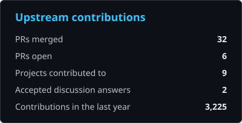
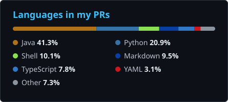

# Ayan Alam

Open source contributor · Java server work & web frontends

I contribute bug fixes, cleanups and docs to open source projects. **{{MERGED_TOTAL}} merged upstream PRs** so far, mostly in Apache HugeGraph and Open Food Facts.

On [Apache HugeGraph](https://github.com/apache/hugegraph) I work across the Server, PD and Store modules and their Docker and Helm setup: running the images as a non-root user, sizing the RocksDB memory budget from available memory, keeping crash diagnostics after a container restart, binding locally loaded graphs in Gremlin Server, removing dead scheduler and election code, and updating the docs to match.

On [Open Food Facts](https://github.com/openfoodfacts) I fix bugs in [Explorer](https://github.com/openfoodfacts/openfoodfacts-explorer) (SvelteKit) and the [Open Prices](https://github.com/openfoodfacts/open-prices-frontend) frontend (Vue).

Outside upstream work I'm building [Alpha Region](https://github.com/byteayan/Alpha-Region-Prototype), a dashboard UI in plain HTML, CSS and JavaScript with hand-rolled canvas charts and an SVG heatmap.

## Upstream work

{{PROJECTS_TABLE}}

## Open PRs

Open pull requests in upstream projects (refreshed automatically).

{{OPEN_PRS}}

## Stats

  
  

## Tools

Java · Python · TypeScript · JavaScript · Scala · SvelteKit · Vue · React · Django · Tailwind CSS · HTML/CSS · Docker · Helm · RocksDB · GitHub Actions · Git

---

Auto-updated {{UPDATED}} · [workflow](.github/workflows/update-readme.yml)
